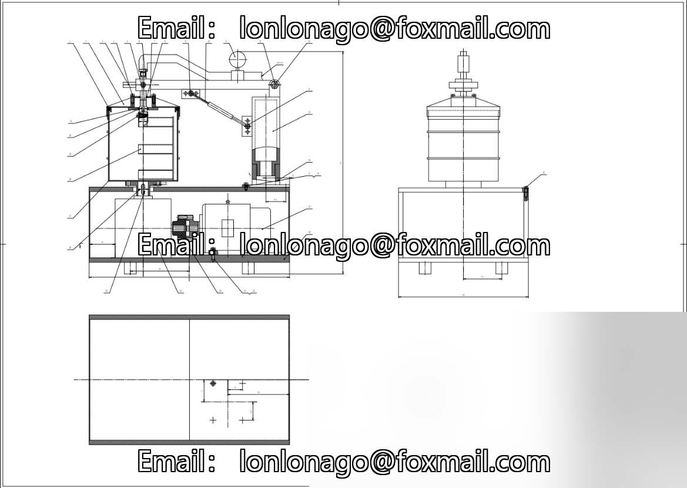
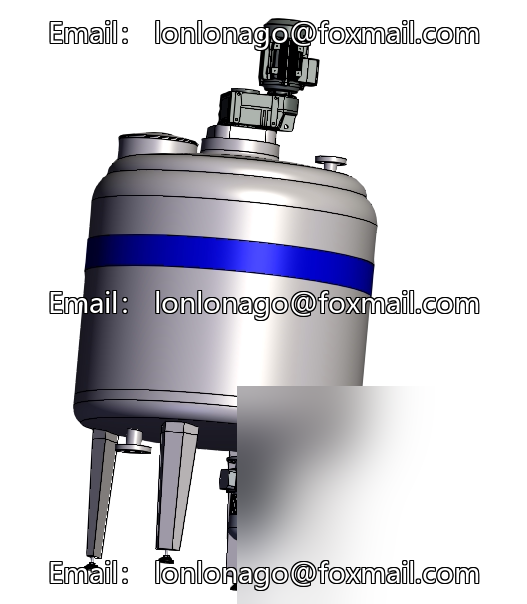
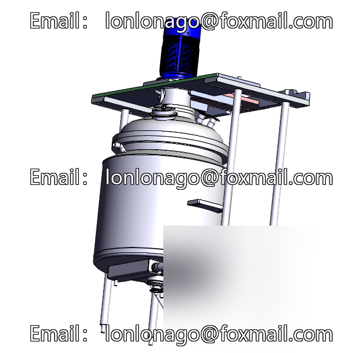
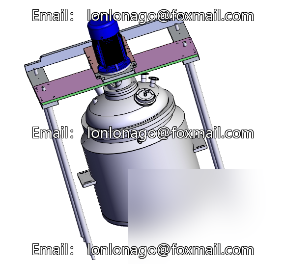

# 534 - Design of vacuum stirrer; design of vacuum stirrer; design of vacuum stirrup; design of vacuum stirrers

## Body

534 - Design of vacuum stirrer; Design of vacuum stirrer; Design of vacuum stirrup; Design of vacuum stirrer; Design of vacuum stirrer CAD drawing
This data includes 2D three-dimensional figures of the vacuum stirrer and 1 CAD drawing of vacuum stirrer design (9 sets) plus a description

The material includes a three-dimensional vacuum stirrer view, CAD drawings and a handbook; the drawings are of types A0, A1, A3 and A4.

<!-- AI_ENRICHED -->

## Images

## Payment

Here is a pay link on Stripe ( https://buy.stripe.com/3cs8yP7sY87d0vu9AB ). Please contact me lonlonago@foxmail.com after funding $89, and I will send you a complete data files , thank you!

